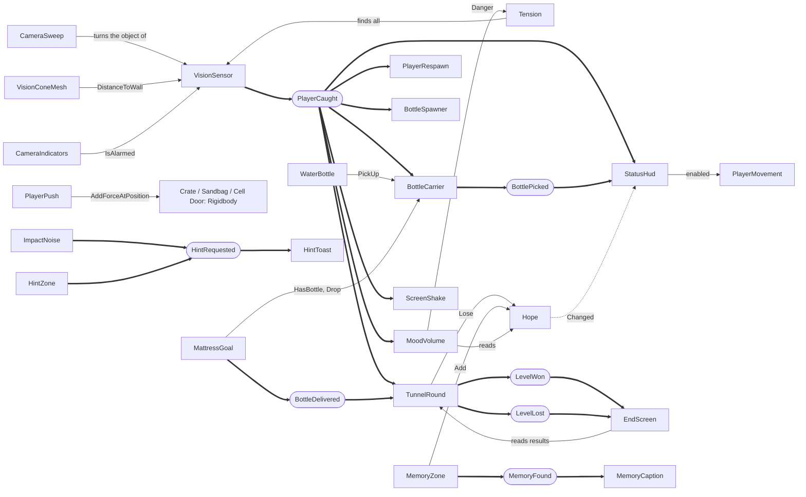
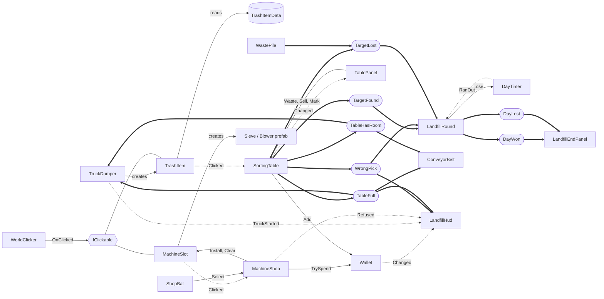
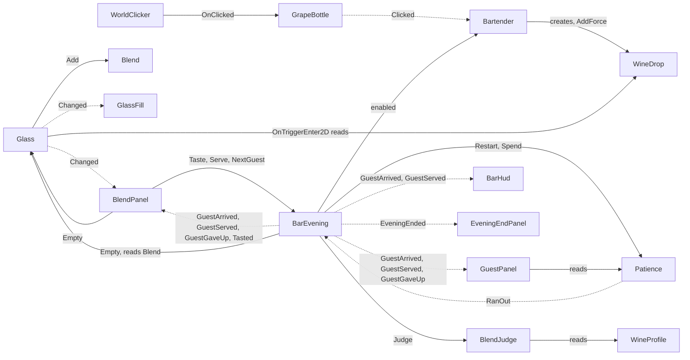

<div dir="rtl" lang="he">

# מטלה 4: תהליכי ליבה, פיסיקה וארכיטקטורה

מימוש תהליך הליבה של שלושת הרעיונות שלנו, בפרויקט יוניטי אחד עם תפריט ראשי:

| משחק | מה עושים | מסמך העיצוב |
|---|---|---|
| אור במנהרה | יוצאים מהתא, עוברים את מצלמת האבטחה בלי להיראות, ומחזירים בקבוק מים למזרן | [Light-in-the-Tunnel](https://github.com/Game-development-Ariel/Light-in-the-Tunnel) |
| ביטקוין קבור | משאיות שופכות זבל על מסוע. קונים מכונות שממיינות אותו, ומוצאים את ארגז הכלים האדום על שולחן המיון לפני שהיום נגמר | [Buried-Bitcoin](https://github.com/Game-development-Ariel/Buried-Bitcoin) |
| בר הבלנדים | לקוח מתאר יין במילים. מוזגים בלנד מהבקבוקים, טועמים, מתקנים ומגישים לפני שנגמרת לו הסבלנות | [Vino-Blend-Bar](https://github.com/Game-development-Ariel/Vino-Blend-Bar) |

בכל משחק מימשנו שלב אחד, עם צורות פשוטות במקום גרפיקה סופית (חוץ מהמנהרה, שממשיכה את מטלה 3).

## קישורים

* המשחק באיץ': יתווסף אחרי ההעלאה
* דיווח על שימוש בבינה מלאכותית: [AI_REPORT.md](AI_REPORT.md)

## איך מריצים

1. פותחים את התיקייה ב-Unity Hub, בגרסה 6000.3.25f1.
2. פותחים את הסצנה `Assets/Scenes/MainMenu` ולוחצים Play.
3. בוחרים משחק בתפריט. Esc או הכפתור Menu מחזירים לתפריט.

התמונות והצלילים שמורים ב-Git LFS, אז אחרי `git clone` צריך להריץ `git lfs pull`.

כל הסצנות נבנות מקוד, בכלי עורך שנמצאים ב-`Assets/Scripts/Editor`. אם משנים משהו בכלים, מריצים `Tools > Rebuild All Scenes`. בנייה לדפדפן: `Tools > Build WebGL`.

## איך משחקים

| משחק | פקדים | ניצחון | הפסד |
|---|---|---|---|
| אור במנהרה | WASD או חצים, M למפה. הולכים לתוך דלת, ארגז או שק חול כדי לדחוף אותם | מביאים את הבקבוק למזרן | כל היתפסות מורידה 25 תקווה. בלי תקווה היום נגמר |
| ביטקוין קבור | עכבר: בוחרים מכונה בחנות ולוחצים על משבצת מעל המסוע. לוחצים על פריט בשולחן ובוחרים Waste, Sell או This is the target | מסמנים את ארגז הכלים האדום כמטרה | הזמן נגמר, או שהמטרה נזרקה לפסולת |
| בר הבלנדים | עכבר: לחיצה על בקבוק מוזגת 10% לכוס. Taste, Empty glass, Serve | ממוצע של 3 כוכבים לפחות בשלושה לקוחות | ממוצע נמוך מ-3 כוכבים |

## פיסיקה

| תכונה | איפה | קובץ |
|---|---|---|
| CharacterController | השחקן במנהרה | [PlayerMovement.cs](Assets/Scripts/Tunnel/Player/PlayerMovement.cs) |
| Rigidbody ו-Rigidbody2D | במנהרה: ארגזים ושקי חול שאפשר לדחוף, ודלת התא. במזבלה: הפריטים על המסוע. בבר: טיפות היין | [TutorialMapBuilder.cs](Assets/Scripts/Editor/Tunnel/TutorialMapBuilder.cs), [TrashItem.cs](Assets/Scripts/Landfill/Items/TrashItem.cs), [WineDrop.cs](Assets/Scripts/WineBar/Pouring/WineDrop.cs) |
| AddForce ו-AddTorque | השחקן במנהרה דוחף ארגזים, שקי חול ואת הדלת בכוח שמופעל בנקודת המגע. המשאית זורקת פריט עם דחיפה וסיבוב. הברמן זורק טיפה בקשת שמחושבת כך שתנחת בכוס | [PlayerPush.cs](Assets/Scripts/Tunnel/Player/PlayerPush.cs), [TruckDumper.cs](Assets/Scripts/Landfill/Trucks/TruckDumper.cs), [Bartender.cs](Assets/Scripts/WineBar/Pouring/Bartender.cs) |
| Raycast | מצלמת האבטחה: קרניים שנעצרות בקיר קובעות גם מה היא רואה וגם איך נראה קונוס הראייה | [VisionSensor.cs](Assets/Scripts/Tunnel/Security/VisionSensor.cs) |
| Collision ו-Collision2D | במנהרה: ארגז שנדחף בודק במה פגע ובאיזו מהירות, ומכה חזקה בקיר עושה רעש. במזבלה: ערמת הפסולת בודקת במה היא פגעה, ואם זה פריט המטרה היום נכשל | [ImpactNoise.cs](Assets/Scripts/Tunnel/Level/ImpactNoise.cs), [WastePile.cs](Assets/Scripts/Landfill/Machines/WastePile.cs) |
| אפקטורים ומחברים (רשות) | דלת התא במנהרה תלויה על HingeJoint ונפתחת כשנשענים עליה. המסוע הוא SurfaceEffector2D. המפוח הוא AreaEffector2D בלי סקריפט בכלל: הכוח שווה לכל הפריטים, אז רק הקלים מתרוממים | [ConveyorBelt.cs](Assets/Scripts/Landfill/Machines/ConveyorBelt.cs), [Blower.prefab](Assets/Prefabs/Landfill/Blower.prefab) |

יש גם טריגרים שבודקים תכונות: הנפה ([Sieve.cs](Assets/Scripts/Landfill/Machines/Sieve.cs)) מפילה דרך המסוע רק פריטים קטנים, והכוס ([Glass.cs](Assets/Scripts/WineBar/Pouring/Glass.cs)) בודקת איזה זן יש בטיפה שנכנסה.

## מבנה התיקיות

<div dir="ltr">

```
Assets/
├── Scripts/
│   ├── Shared/      Events/ (GameEvent, TextEvent)   Input/ (IClickable, WorldClicker)
│   │                UI/ (UiFactory, MainMenu, ResultOverlay, ...)   Audio/ (Sfx)
│   ├── Tunnel/      Player/  Security/  Items/  Level/  Game/  UI/  Effects/  Audio/  Camera/
│   ├── Landfill/    Items/  Trucks/  Machines/  Shop/  Sorting/  Game/  UI/
│   ├── WineBar/     Wine/  Pouring/  Guests/  Game/  UI/
│   └── Editor/      the tools that build the scenes
├── Data/            Tunnel/  Landfill/  WineBar/   (ScriptableObject assets: events and numbers)
├── Prefabs/
└── Scenes/          MainMenu, Tutorial (the tunnel), Landfill, WineBar
```

</div>

בכל משחק התיקייה `Game` מחזיקה את החוקים (מתי מנצחים ומפסידים) והתיקייה `UI` רק מציגה. קוד המשחק לא מכיר את קוד הממשק: הממשק מאזין לאירועים של המשחק, ולא להפך. בכיוון ההפוך מותר: רכיב ממשק יכול לקרוא ערך מהמשחק או לקרוא לפונקציה שלו (כפתור Serve קורא ל-`BarEvening.Serve`).

## יחסי המחלקות

יש שני סוגי אירועים:

* **אירוע כנכס** ([GameEvent](Assets/Scripts/Shared/Events/GameEvent.cs), [TextEvent](Assets/Scripts/Shared/Events/TextEvent.cs)): ScriptableObject שרכיב אחד מרים ואחרים מאזינים לו. השולח והמאזינים מחזיקים רק את הנכס ולא מכירים זה את זה. משתמשים בו כשיש הרבה מאזינים שלא קשורים אחד לשני.
* **אירוע רגיל של C#** (`event Action`): כשהמאזין ממילא מחזיק הפניה לשולח, כמו ה-HUD שמציג את התקווה.

כל הרשמה נעשית ב-`OnEnable` ומבוטלת ב-`OnDisable`. יוצא מן הכלל אחד: שולחן המיון נרשם ללחיצות של פריט כשהפריט נוחת עליו, ומבטל כשהפריט יורד ממנו.

בתרשימים: מלבן הוא מחלקה, צורה מעוגלת היא אירוע כנכס (חץ עבה), וחץ מקווקו הוא אירוע רגיל של C#. חץ רגיל הוא קריאה ישירה.

### אור במנהרה

<div dir="ltr">



</div>

| אירוע | מי שולח | מי מקבל |
|---|---|---|
| PlayerCaught | VisionSensor | TunnelRound (מוריד תקווה), BottleCarrier (מפיל את הבקבוק), PlayerRespawn (מחזיר לתא), BottleSpawner (בקבוק חדש), StatusHud, MoodVolume, ScreenShake |
| BottlePicked | BottleCarrier | StatusHud |
| BottleDelivered | MattressGoal | TunnelRound |
| LevelWon, LevelLost | TunnelRound | EndScreen |
| HintRequested | HintZone, ImpactNoise | HintToast |
| MemoryFound | MemoryZone | MemoryCaption |
| Hope.Changed | Hope | StatusHud |

המצלמה בנויה מרכיבים קטנים על אותו אובייקט: CameraSweep מסובב, VisionSensor רואה, VisionConeMesh מצייר את מה שהחיישן רואה, ו-CameraIndicators מוסיף נורה וזמזום.

### ביטקוין קבור

<div dir="ltr">



</div>

| אירוע | מי שולח | מי מקבל |
|---|---|---|
| TableFull, TableHasRoom | SortingTable | ConveyorBelt (עוצר וממשיך), TruckDumper (מחכה). את TableFull מקבל גם LandfillHud |
| TargetFound, WrongPick | SortingTable | LandfillRound (ניצחון, או קנס זמן). את WrongPick מקבל גם LandfillHud |
| TargetLost | WastePile, SortingTable | LandfillRound |
| DayWon, DayLost | LandfillRound | LandfillEndPanel |
| Clicked | TrashItem, MachineSlot | SortingTable, MachineShop |
| SortingTable.Changed | SortingTable | TablePanel |
| Changed, TruckStarted, Refused, RanOut | Wallet, TruckDumper, MachineShop, DayTimer | LandfillHud, LandfillRound |

### בר הבלנדים

<div dir="ltr">



</div>

בבר אין אירועים כנכסים. רכיבי הממשק מחזיקים הפניה ל-BarEvening ומאזינים לאירועים רגילים שלו, ובתוך המשחק BarEvening מאזין ל-Patience ו-Bartender מאזין לבקבוקים. הכפתורים קוראים לפונקציות של BarEvening, אבל BarEvening לא יודע שיש כפתורים.

## החלטות ארכיטקטורה

**1. אירועים כנכסים במקום GameManager.** במטלה 3 היה `GameManager` שהיה סינגלטון: המצלמה קראה ל-`GameManager.Instance.RegisterCapture()`, וה-HUD קרא ממנו את החיים בכל פריים. הוא החזיק את החיים, את הבקבוק, את מספר ההיתפסויות ואת מעבר הסצנות, וכל שינוי במשחק נגע בו. עכשיו המצלמה רק מרימה את `PlayerCaught`, וכל מי שצריך מגיב בעצמו. את GameManager פירקנו ל-Hope, BottleCarrier, PlayerRespawn ו-TunnelRound. החלופה הייתה להשאיר את הסינגלטון ולהוסיף לו אירועים, אבל אז עדיין כולם היו תלויים במחלקה אחת.

**2. CharacterController במנהרה, בלי לבנות אותה מחדש בתלת-ממד.** המנהרה מצוירת בדו-ממד (Tilemap ותאורה דו-ממדית), ו-CharacterController הוא רכיב תלת-ממדי. החלופה הייתה לבנות את כל המנהרה מחדש מקוביות, אבל אז היינו מאבדים את התאורה והאווירה ממטלה 3. במקום זה השארנו את הציור כמו שהוא והחלפנו רק את הפיסיקה: לכל קיר שנוגע ברצפה יש BoxCollider תלת-ממדי, השחקן הוא CharacterController שהגובה שלו שווה לפעמיים הרדיוס (כלומר כדור) והוא זז על מישור X-Y, והמצלמה משתמשת ב-`Physics.Raycast`. השחקן נמצא בשכבה Ignore Raycast, כדי שהקרניים ייעצרו רק בקירות. על הקירות נשאר גם קוליידר דו-ממדי, רק כי הצללים של התאורה לוקחים ממנו את הצורה.

**3. מסך הסיום באותה סצנה.** במטלה 3 מסך הסיום היה סצנה נפרדת, ולכן ה-GameManager היה צריך לשרוד את המעבר (DontDestroyOnLoad) כדי להעביר את התוצאות. עכשיו EndScreen יושב בסצנת השלב, מאזין ל-`LevelWon` ו-`LevelLost` ומכסה את המסך. אין מידע שעובר בין סצנות, ולכן לא צריך אובייקט ששורד. "Play again" פשוט טוען את הסצנה מחדש.

**4. נתונים בנכסים.** כל המספרים לכוונון נמצאים ב-`Assets/Data`: הגדרות השלב ([TunnelLevelSettings](Assets/Scripts/Tunnel/Game/TunnelLevelSettings.cs), [LandfillDaySettings](Assets/Scripts/Landfill/Game/LandfillDaySettings.cs), [BarEveningSettings](Assets/Scripts/WineBar/Game/BarEveningSettings.cs)), סוגי הפריטים, המכונות, הזנים והראייה של המצלמה. מה שלא בנכס הוא שדה ב-Inspector. החלופה הייתה קבועים בקוד, כמו `GrapeDatabase` הסטטי באב-הטיפוס של הבר.

## איך מוסיפים דברים

**אויב חדש במנהרה, למשל שומר שמסתובב.** כותבים סקריפט אחד חדש, `GuardPatrol.cs` בתיקייה `Tunnel/Security`, שמזיז את השומר בין נקודות. על אותו אובייקט שמים את VisionSensor ו-VisionConeMesh הקיימים, עם נכס VisionStats חדש (למשל ראייה קצרה ורחבה יותר), ומוסיפים אותו למפה ב-[TutorialMapBuilder.cs](Assets/Scripts/Editor/Tunnel/TutorialMapBuilder.cs). שום קובץ אחר לא משתנה, כי השומר מרים את אותו `PlayerCaught`, וכל מה שקורה כשנתפסים (תקווה, חזרה לתא, בקבוק, מסך, צליל) כבר מאזין לו. גם Tension, שמגביר את הדופק ליד סכנה, מחפש כל VisionSensor ולא "מצלמה".

**פריט חדש במזבלה.** יוצרים נכס TrashItemData חדש (`Create > Landfill > Trash Item`) ומוסיפים אותו למשאית בנכס [Day1Settings](Assets/Data/Landfill/Day1Settings.asset). אין שינוי בקוד: הפריפאב TrashItem לוקח מהנכס צבע, גודל ומשקל, והמכונות בודקות את התכונות שבנכס.

**מכונה חדשה במזבלה, למשל מגנט.** סקריפט חדש `Magnet.cs` בתיקייה `Landfill/Machines`, פריפאב שלו, נכס MachineData עם שם ומחיר, והוספת הנכס לרשימה של ShopBar. צריך גם להוסיף שדה `isMetal` ל-TrashItemData. החנות, המשבצות והכסף לא משתנים, כי הם מכירים רק MachineData.

**זן חדש בבר.** נכס GrapeData חדש ובקבוק נוסף על המדף ב-[WineBarSceneBuilder.cs](Assets/Scripts/Editor/WineBar/WineBarSceneBuilder.cs). החישוב של הבלנד והניסוח של הלקוחות עובדים על כל זן.

**לקוח חדש בבר.** מוסיפים שורה לרשימת guests בנכס [Day1Settings](Assets/Data/WineBar/Day1Settings.asset): שם, בלנד וניחוחות. מה שהלקוח אומר נבנה מהבלנד.

## סינגלטון ומשתנים סטטיים

אין סינגלטון בפרויקט. ה-GameManager ממטלה 3 נמחק, וגם `Tension.Danger` ו-`ScreenShake.Shake` שהיו סטטיים הפכו לרכיבים רגילים.

מה שנשאר סטטי:

| איפה | מה | למה |
|---|---|---|
| [Sfx](Assets/Scripts/Shared/Audio/Sfx.cs) | מחלקה סטטית עם AudioSource אחד | צליל קצר צריך להמשיך להתנגן גם כשהסצנה מתחלפת (למשל הקליק של Play again), אז המקור שלו לא יכול להיות שייך לסצנה. זה רק שירות השמעה, ואין בו מצב של המשחק |
| [ScreenFader](Assets/Scripts/Shared/UI/ScreenFader.cs) | `FadeAndLoad` סטטית ודגל `isFading` | המסך השחור חייב לשרוד את טעינת הסצנה כדי להתבהר אחריה. הדגל מונע טעינה כפולה אם שני כפתורים נלחצים יחד |
| UiFactory, UiAnim, UiTheme, ResultOverlay, WineWords, SceneNames | מחלקות סטטיות של פונקציות עזר וקבועים | אין בהן מצב, רק פונקציות שמקבלות קלט ומחזירות פלט. אובייקט לא היה מוסיף כלום |
| `MobileJoystick.UsesTouch` | תכונה סטטית | שאלה על המכשיר ולא על אובייקט מסוים |

## מה השתנה לעומת מסמכי העיצוב

* **ביטקוין קבור** מוצג מהצד ולא מלמעלה, כדי שכוח הכבידה יעשה חלק מהמיון: פריטים קטנים נופלים דרך הנפה, ופריטים קלים עפים במפוח. יש שלוש משבצות קבועות למכונות במקום רשת חופשית. השלב הוא יום 1 מקוצר, עם מגבלת זמן כדי שיהיה תנאי הפסד.
* **בר הבלנדים**: במקום כפתורי פלוס ומינוס, לוחצים על הבקבוק והיין נזרק לכוס. אי אפשר להוריד זן אחד, רק לרוקן את הכוס. בשלב יש שלושת הלקוחות הראשונים של יום 1.
* **אור במנהרה**: בשלב הלימוד אפשר עכשיו להפסיד (התקווה יורדת עד 0), כדי שתנאי ההפסד יעבוד. נוספו דברים שאפשר לדחוף: דלת התא נפתחת על ציר, יש ארגז בתא וארגז במסדרון שאפשר לדחוף לפניך כמחסה מהמצלמה (הקרניים שלה נעצרות בו), ושני שקי חול חוסמים את הכניסה למחסן, כהכנה לחפירה בשקי החול שבמסמך השלבים.

## חברי הצוות

* דוד בלוך ([davidbloch18](https://github.com/davidbloch18))
* עומרי סבג ([omrisabag2001](https://github.com/omrisabag2001))

</div>
